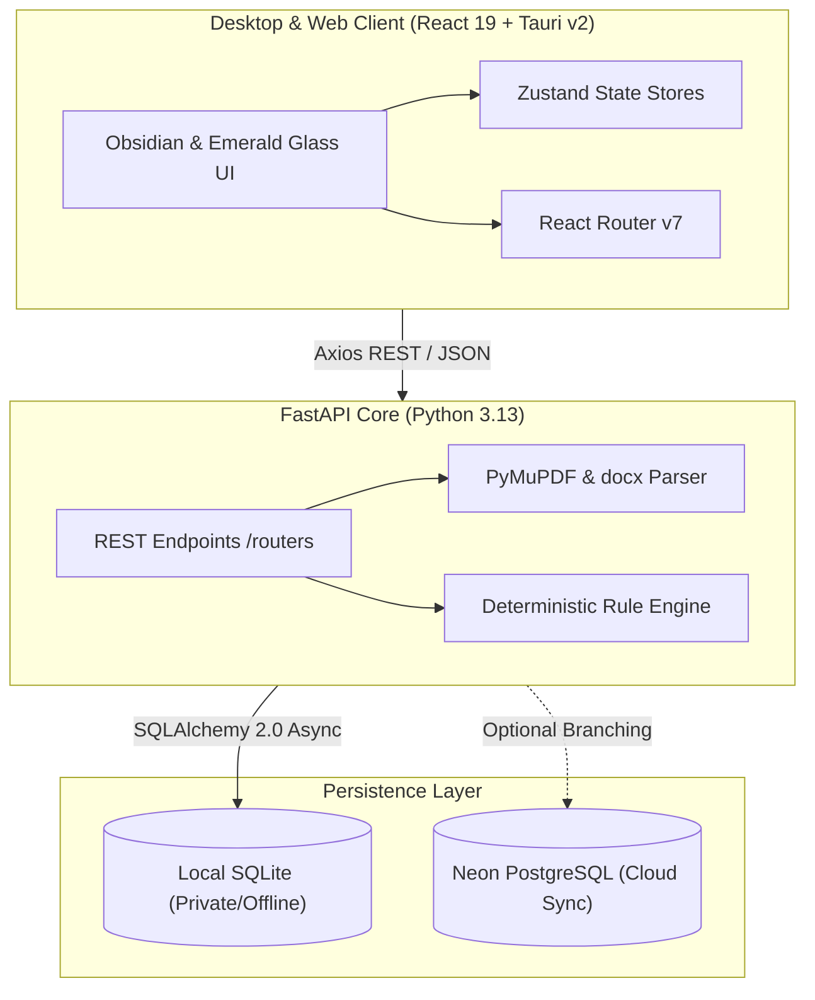

# Career Companion

<div align="center">


### A focused, local-first engineering workbench for technical job searches.

[](https://react.dev)
[](https://fastapi.tiangolo.com)
[](https://tauri.app)
[](https://vite.dev)
[](https://neon.tech)
[](LICENSE)

[**Explore Features**](#-key-capabilities) • [**System Architecture**](#-system-architecture) • [**Quick Start**](#-quick-start) • [**Tech Stack**](#-technical-stack) • [**About the Project**](#-about-the-developer)

</div>

---

## ✦ Overview

**Career Companion** is an integrated desktop & web workspace designed to eliminate fragmented spreadsheets, aggressive recruitment paywalls, and noisy AI gimmicks. 

Built with an **Obsidian & Emerald Glass** aesthetic, it combines local-first privacy with deterministic evaluation frameworks—allowing engineering and AI/DS candidates to parse resumes, benchmark competencies against live job requirements using Google XYZ rubrics, practice timed STAR interviews, and manage the complete hiring lifecycle under one unified surface.

---

## ✦ Key Capabilities

```
┌────────────────────────────────────────────────────────────────────────┐
│                        CAREER COMPANION WORKBENCH                      │
├─────────────────┬──────────────────┬─────────────────┬─────────────────┤
│  Resume Studio  │   Job Matcher    │ Kanban Pipeline │  STAR Simulator │
│  • Google XYZ   │   • Deterministic│ • 5-Stage Board │  • Zen Countdown│
│  • ATS Health   │   • 1-Click Apply│ • Salary Insights│  • Scoring     │
└─────────────────┴──────────────────┴─────────────────┴─────────────────┘
```

### 1. Executive Dashboard & Pipeline Flow
- **Time-Aware Overview**: Personalized greeting with quick pipeline health metrics.
- **KPI Metrics**: Total Tracked, In Interview, ATS Health, and Compatibility Averages with circular radial progress rings.
- **Visual Progression Strip**: Horizontal stage tracker (`Wishlist → Applied → Interviewing → Offer`).
- **Interview Spotlight**: Countdown timer and date alert for upcoming interview rounds.

### 2. Resume Studio & Google XYZ Accomplishment Rewriter
- **Deterministic ATS Scoring**: Ingests PDF and DOCX documents to evaluate structure, formatting standards, and section hierarchy.
- **Google XYZ Formula Engine**: Reformulates accomplishments following `[Accomplished X] as measured by [Y], by doing [Z]` with instant before-and-after score feedback.
- **Taxonomy Skill Cloud**: Automatically tags detected skills across languages, frameworks, cloud platforms, and developer tooling.

### 3. Tech Job Discovery & 1-Click Easy Apply
- **Curated Openings**: Aggregates technical roles across major Indian tech hubs (Bengaluru, Pune, Hyderabad, NCR) and verified remote engineering teams.
- **Compatibility Vector Matching**: Pinpoints matching strengths and highlights missing technical qualifications.
- **1-Click Easy Apply**: Links candidate's active resume and custom notes directly into the application pipeline as `"applied"`.

### 4. Kanban & Tabular Application Tracker
- **Dual View Modes**: Seamless toggle between interactive **Kanban Board** and high-density **Table View**.
- **Stage Management**: 5 stages (`Wishlist`, `Applied`, `Interviewing`, `Offer`, `Rejected`) with instant status transitions.
- **Private Notes**: Glassmorphic modal to log recruiter correspondence, compensation bands, and technical interview feedback.

### 5. Executive Outreach Studio
- **Tailored Correspondence**: Generates role-specific cover letters and concise LinkedIn referral requests.
- **Zero Hallucinated Filler**: Anchors copy strictly to candidate skills and target company technical requirements.
- **Real-Time Markdown Export**: One-click copy or `.md` file download with live word and character counters.

### 6. STAR Interview Preparation Simulator
- **Zen Practice Interface**: Minimalist timed practice mode with start, pause, and reset controls.
- **Categorized Question Bank**: Technical system design, algorithmic problem-solving, and leadership prompts.
- **STAR Rubric Helper**: Real-time evaluation guidance across *Situation*, *Task*, *Action*, and *Result*.

---

## ✦ System Architecture

Career Companion adopts a decoupled, local-first architecture combining asynchronous Python services with a modern React 19 / Tauri desktop client:



---

## ✦ Technical Stack

| Layer | Technology | Details |
| :--- | :--- | :--- |
| **Frontend Framework** | **React 19** + **TypeScript** | Strict type safety, clean functional hooks, modular primitives |
| **Desktop Runtime** | **Tauri v2** | Rust-backed lightweight desktop environment with native OS shell |
| **Styling & System** | **Tailwind CSS v4** + **CSS Tokens** | Custom Obsidian & Emerald Glass palette, hardware-accelerated blur |
| **Animation** | **Framer Motion 12** | Sliding pill tabs, layout animations, micro-interactions |
| **Backend Engine** | **FastAPI** (Python 3.13) | Asynchronous REST API, Pydantic v2 data models |
| **Persistence** | **SQLAlchemy 2.0 Async** | Dual-driver architecture supporting local SQLite & cloud Neon PostgreSQL |
| **Document Parsing** | **PyMuPDF** & **python-docx** | Offline resume tokenization without external API dependencies |

---

## ✦ Quick Start

### Prerequisites
- **Node.js** `>= 20.x` and **pnpm** `>= 9.x`
- **Python** `>= 3.11` (Python 3.13 recommended)
- *(Optional for Desktop App)* **Rust** toolchain for Tauri v2

### 1. Clone the Repository
```bash
git clone https://github.com/NinadPanchal/Career-Companion.git
cd Career-Companion
```

### 2. Install Dependencies
```bash
# Install frontend workspace dependencies
pnpm install

# Setup backend Python environment
cd apps/api
python3 -m venv .venv
source .venv/bin/activate
pip install -r requirements.txt
cd ../..
```

### 3. Launch Services (Single Command)
Run the automated startup script from the root directory:
```bash
./start.sh
```
*or using pnpm:*
```bash
pnpm start
```

This launches:
- **FastAPI Backend**: [`http://127.0.0.1:8000`](http://127.0.0.1:8000) (Interactive Swagger docs at [`/docs`](http://127.0.0.1:8000/docs))
- **Web Interface**: [`http://localhost:1420`](http://localhost:1420)

> Press `Ctrl+C` in the terminal to gracefully shut down both services.

### 4. Running as a Native Desktop App
To build and launch the Tauri native desktop window:
```bash
./start.sh desktop
# or
pnpm start:desktop
```

---

## ✦ Available Scripts

| Command | Description |
| :--- | :--- |
| `./start.sh` | Starts both backend API and web frontend concurrently |
| `./start.sh desktop` | Starts backend and launches native Tauri window |
| `pnpm dev` | Starts the Vite web client on port `1420` |
| `pnpm dev:api` | Starts the FastAPI backend with uvicorn on port `8000` |
| `pnpm dev:desktop` | Launches the Tauri development app |
| `pnpm build` | Generates the optimized frontend bundle |

---

## ✦ Project Directory Structure

```
Career-Companion/
├── apps/
│   ├── api/                     # Python FastAPI Backend
│   │   ├── app/
│   │   │   ├── core/            # Database engine & configurations
│   │   │   ├── models/          # SQLAlchemy async ORM models
│   │   │   ├── routers/         # REST routers (jobs, resume, ai, applications)
│   │   │   └── services/        # Scoring heuristics & document extractors
│   │   ├── main.py              # Application entrypoint & CORS middleware
│   │   └── requirements.txt     # Python dependencies
│   │
│   └── desktop/                 # React 19 + Tauri v2 Frontend
│       ├── src/
│       │   ├── components/      # Reusable UI primitives (Card, Button, Badge, Tabs)
│       │   ├── features/        # Domain stores (applications, jobs, resume, ai)
│       │   ├── layouts/         # DashboardLayout & Navigation shells
│       │   ├── pages/           # Workspaces (Dashboard, Applications, Jobs, Resume...)
│       │   ├── theme/           # tokens.css & utilities.css
│       │   └── main.tsx         # React root mounting
│       ├── src-tauri/           # Rust Tauri v2 window configuration
│       └── package.json
│
├── scripts/                     # Operational automation scripts
├── start.sh                     # Unified startup script
└── package.json                 # Monorepo workspace configuration
```

---

## ✦ Engineering Principles

1. **Data Sovereignty First**: Resumes, candidate notes, and application records stay on the user's local disk or private database instance.
2. **Zero Simulated Noise**: No synthetic delays, no artificial crypto hashes, and no fake telemetry counters.
3. **Deterministic Evaluation**: Scoring metrics use concrete grammar taxonomies, action-verb counts, and Google XYZ frameworks rather than unpredictable generative hallucinations.
4. **Resilient Offline Fallback**: All critical parsing and keyword comparison tools run without requiring external cloud accounts.

---

## ✦ About the Developer

**Career Companion** was designed and developed by **Ninad Panchal**, a final-year Bachelor of Engineering student specializing in **Artificial Intelligence & Data Science** in Mumbai, India.

- **LinkedIn**: [linkedin.com/in/ninadpanchal](https://linkedin.com/in/ninadpanchal)
- **GitHub**: [github.com/NinadPanchal](https://github.com/NinadPanchal)
- **Email**: [local@career-companion.app](mailto:local@career-companion.app)

---

## ✦ License

This project is licensed under the [MIT License](LICENSE).
